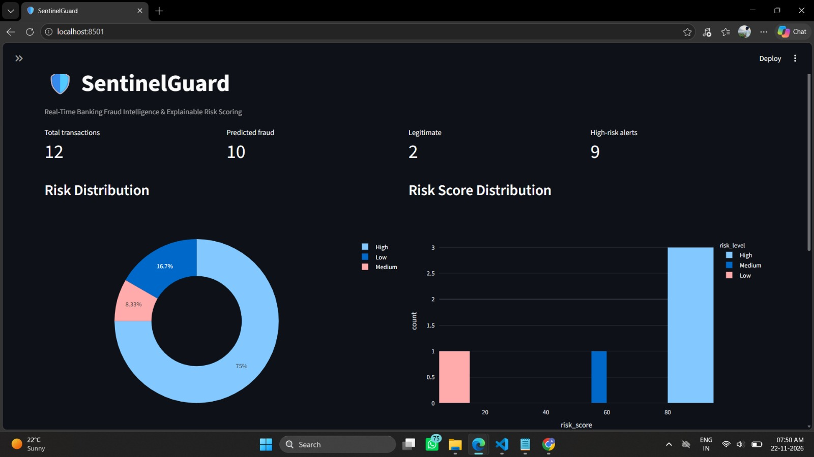
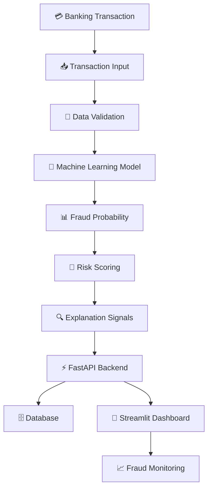

# 🛡️ SentinelGuard
### Real-Time Banking Fraud Intelligence & Explainable Risk Scoring Platform

<p align="center">
  
  
  
  
  
</p>

<p align="center">
  <b>🚀 Detect Fraud. Analyze Risk. Protect Every Transaction.</b>
</p>

<p align="center">
  An intelligent machine learning platform that detects suspicious banking transactions, calculates fraud probability, generates risk scores, and provides explainable insights through an interactive dashboard.
</p>

<p align="center">
  <a href="https://github.com/Abhi-munnoli/SentinelGuard">
    
  </a>
  
  
</p>

---

## 🌟 About SentinelGuard

**SentinelGuard** is a machine learning-based banking fraud detection and risk intelligence platform designed to identify potentially suspicious financial transactions.

The platform analyzes transaction attributes, predicts fraud probability, calculates a risk score from 0 to 100, and classifies transactions into Low, Medium, and High risk categories.

It combines machine learning, backend APIs, and interactive data visualization to make fraud analysis more accessible and understandable.

### 🎯 Our Mission

To make digital banking smarter, safer, and more transparent through machine learning and explainable artificial intelligence.

---

## ✨ Key Features

| Feature | Description |
|---|---|
| 🤖 Machine Learning Detection | Identifies potentially fraudulent transactions |
| 📊 Intelligent Risk Scoring | Generates risk scores between 0 and 100 |
| 🚦 Risk Classification | Categorizes transactions into Low, Medium, and High risk |
| 🔍 Explainable AI | Displays available transaction explanation signals |
| ⚡ Transaction Analysis | Processes transaction analysis through FastAPI |
| 📈 Interactive Dashboard | Visualizes transaction and fraud statistics |
| 🗄️ Transaction History | Stores and displays previously analyzed transactions |
| 📥 CSV Export | Downloads transaction reports |
| 🔄 Batch Prediction | Supports multiple transaction predictions |

---

# 📸 Application Screenshots

Explore the SentinelGuard application interface and its major functionalities.

### 🏠 01. Dashboard Overview

The main dashboard provides a consolidated view of transaction statistics, predicted fraud, legitimate transactions, high-risk alerts, and risk distribution.

<p align="center">
  
</p>

### 🔍 02. Analyze Transaction

Enter transaction details and analyze potentially suspicious banking activities using the machine learning model.

<p align="center">
  
</p>

### 🟢 03. Low-Risk Transactions

View transactions classified as low risk, indicating a lower predicted fraud probability.

<p align="center">
  
</p>

### 🟡 04. Medium-Risk Transactions

Identify transactions that may require additional verification and monitoring.

<p align="center">
  
</p>

### 🔴 05. High-Risk Transactions

Highlight potentially suspicious transactions requiring priority human review.

<p align="center">
  
</p>

### 📜 06. Transaction History

Review previously analyzed transactions, filter records by risk level, and download transaction reports in CSV format.

<p align="center">
  
</p>

---

## 🧠 System Architecture & Workflow

SentinelGuard follows a transaction analysis workflow that connects user input, data validation, machine learning prediction, risk scoring, and dashboard visualization.



### Workflow Explanation

1. User enters banking transaction details.
2. Backend validates the transaction data.
3. Machine learning model analyzes the transaction.
4. Fraud probability is calculated.
5. A risk score is generated.
6. Transaction is classified into a risk category.
7. Available explanation signals are returned.
8. Transaction information is stored in the database.
9. Dashboard displays prediction results and analytics.

---

## 🚦 Risk Classification System

SentinelGuard uses a risk score ranging from 0 to 100 to categorize transactions.

| Score Range | Risk Category | Suggested Action |
|:---:|:---:|---|
| 🟢 0–30 | **Low Risk** | Normal monitoring |
| 🟡 31–70 | **Medium Risk** | Additional verification |
| 🔴 71–100 | **High Risk** | Priority human review |

> **Important:** A high-risk prediction is not proof of fraud. Human verification should be performed before taking action.

---

## 🛠️ Technology Stack

| Category | Technologies |
|---|---|
| Programming Language | Python |
| Data Processing | Pandas, NumPy |
| Machine Learning | Scikit-learn, Random Forest |
| Model Enhancements | XGBoost, SMOTE |
| Explainable AI | SHAP, LIME |
| Backend Framework | FastAPI, Pydantic |
| Frontend Framework | Streamlit |
| Data Visualization | Plotly |
| Database | SQLite, PostgreSQL |
| ORM | SQLAlchemy |
| Deployment Plans | Docker, AWS |
| Version Control | Git, GitHub |

*Some technologies are planned enhancements and may not yet be integrated into the current implementation.*

---

## 📂 Project Structure

```text
SentinelGuard/
│
├── backend/
│   ├── main.py
│   └── database.py
│
├── frontend/
│   └── app.py
│
├── src/
│   ├── preprocessing/
│   │   └── validation.py
│   │
│   ├── prediction/
│   │   └── engine.py
│   │
│   └── training/
│       └── train.py
│
├── data/
│   └── transactions.csv
│
├── models/
│   └── trained_model.pkl
│
├── screenshots/
│   ├── dashboard.png
│   ├── analyze-transaction.png
│   ├── low-risk.png
│   ├── medium-risk.png
│   ├── high-risk.png
│   └── transaction-history.png
│
├── tests/
├── requirements.txt
├── README.md
└── .gitignore
```

---

## ⚙️ Installation & Setup

Follow these steps to run SentinelGuard locally.

### 1. Clone the Repository

```bash
git clone https://github.com/Abhi-munnoli/SentinelGuard.git
```

### 2. Navigate to the Project Directory

```bash
cd SentinelGuard
```

### 3. Create a Virtual Environment

```bash
python -m venv venv
```

Activate the environment on Windows:

```bash
venv\Scripts\activate
```

### 4. Install Dependencies

```bash
pip install -r requirements.txt
```

### 5. Train the Machine Learning Model

```bash
python -m src.training.train
```

### 6. Start the FastAPI Backend

```bash
uvicorn backend.main:app --reload
```

**Backend URL:** `http://127.0.0.1:8000`

**API Documentation:** `http://127.0.0.1:8000/docs`

### 7. Start the Streamlit Dashboard

Open another terminal and execute:

```bash
streamlit run frontend/app.py
```

**Dashboard URL:** `http://localhost:8501`

<p align="center">
  <b>🎉 SentinelGuard is ready to run locally!</b>
</p>

---

## 🧪 Example Transaction Inputs

The following examples illustrate different transaction scenarios.

### 🟢 Low-Risk Example

```json
{
  "amount": 500,
  "hour": 14,
  "distance_from_home": 2,
  "merchant_risk": 0.05,
  "transaction_velocity": 1,
  "is_foreign": 0,
  "device_changed": 0
}
```

### 🟡 Medium-Risk Example

```json
{
  "amount": 15000,
  "hour": 21,
  "distance_from_home": 80,
  "merchant_risk": 0.50,
  "transaction_velocity": 4,
  "is_foreign": 0,
  "device_changed": 1
}
```

### 🔴 High-Risk Example

```json
{
  "amount": 50000,
  "hour": 2,
  "distance_from_home": 450,
  "merchant_risk": 0.95,
  "transaction_velocity": 8,
  "is_foreign": 1,
  "device_changed": 1
}
```

*These are illustrative scenarios. The trained model determines the actual prediction and risk score.*

---

## 🔍 Explainable Artificial Intelligence

SentinelGuard aims to make fraud predictions more understandable by displaying transaction-related explanation signals.

### Transaction Attributes Analyzed

- 💰 Transaction amount
- 🕒 Transaction time
- 📍 Distance from home
- 🏪 Merchant risk
- 🔄 Transaction velocity
- 🌍 Foreign transaction
- 📱 New device detection

SHAP and LIME can provide more detailed feature-contribution explanations when fully integrated.

---

## 🔌 API Endpoints

| HTTP Method | Endpoint | Description |
|:---:|---|---|
| `GET` | `/health` | Backend health check |
| `POST` | `/predict` | Predict an individual transaction |
| `POST` | `/predict/batch` | Predict multiple transactions |
| `GET` | `/transactions` | Retrieve transaction history |
| `GET` | `/metrics` | Retrieve dashboard metrics |

---

## 🚀 Future Enhancements

The following improvements are planned to expand SentinelGuard's capabilities:

- ⚡ Advanced XGBoost model comparison
- 🔍 Full SHAP and LIME integration
- 📡 Apache Kafka real-time streaming
- 🗄️ PostgreSQL database integration
- 🔐 User authentication and authorization
- 🚨 Automated fraud alerts
- 🐳 Docker containerization
- ☁️ AWS cloud deployment
- 📊 Advanced model monitoring

---

## 👨‍💻 Developer

<p align="center">
  
</p>

<p align="center">
  <b>Abhinandan Munnoli</b><br/>
  Python | Machine Learning | Artificial Intelligence
</p>

<p align="center">
  <a href="https://github.com/Abhi-munnoli">
    
  </a>
  <a href="https://github.com/Abhi-munnoli/SentinelGuard">
    
  </a>
</p>

---

## ⭐ Support SentinelGuard

If you find this project useful, consider supporting its development!

- ⭐ Star this repository.
- 🍴 Fork the project.
- 🐛 Report bugs and issues.
- 💡 Suggest new features.
- 🤝 Contribute to development.

---

<p align="center">
  <h3 align="center">🛡️ SentinelGuard</h3>
  <b>Smarter Detection. Safer Banking. Stronger Trust.</b>
  <br/><br/>
  Made with ❤️ using Python and Machine Learning.
</p>
