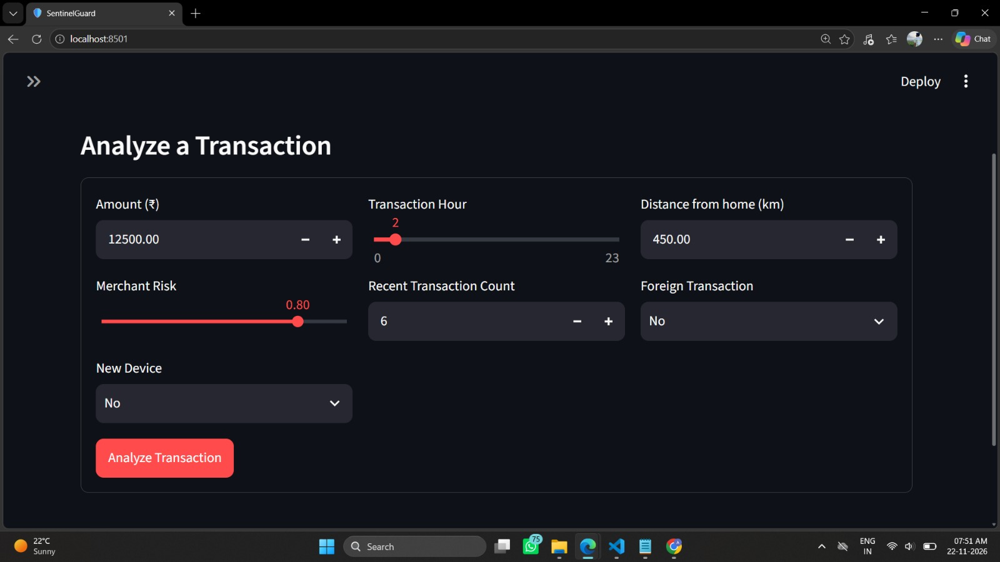
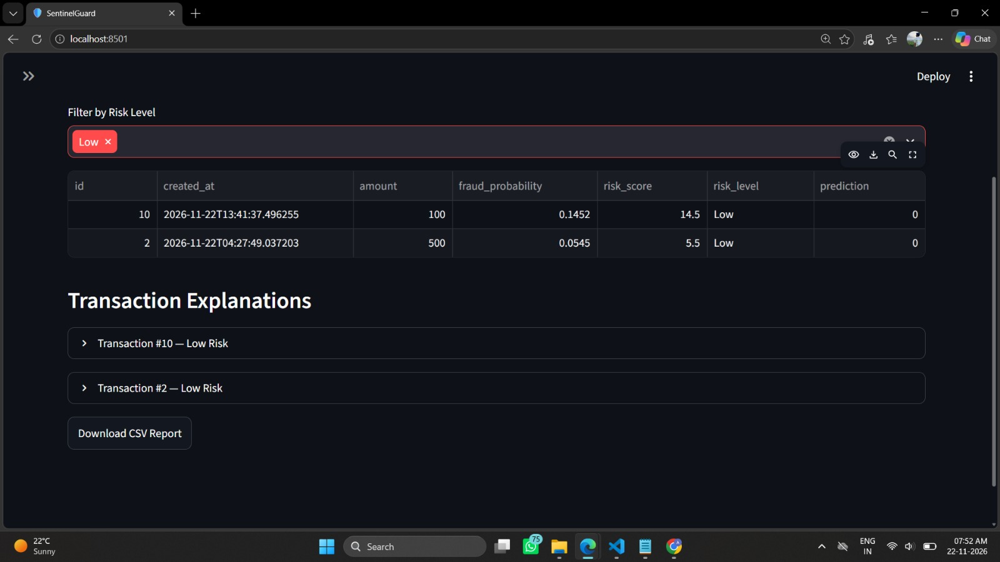
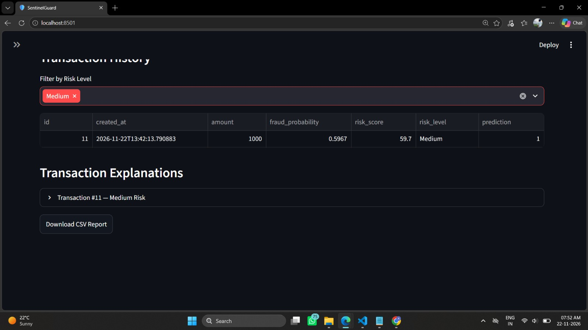
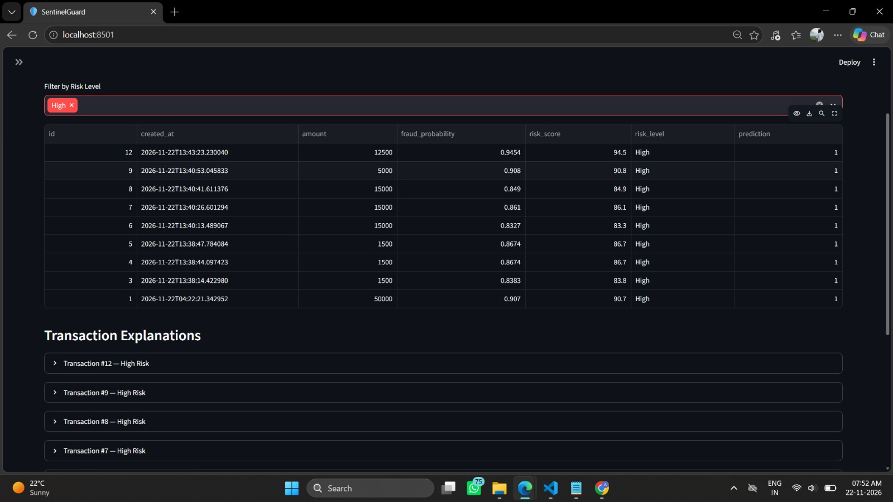
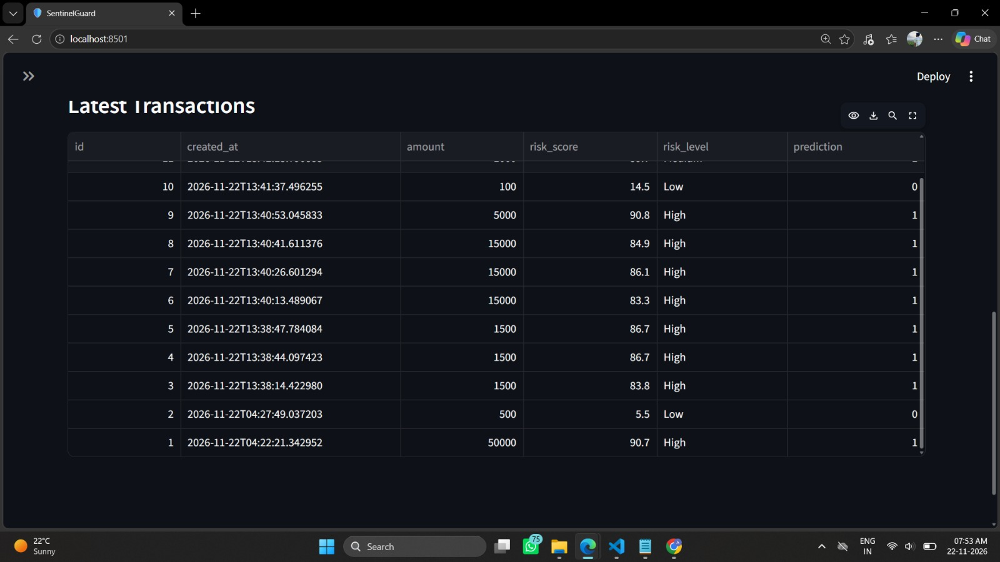
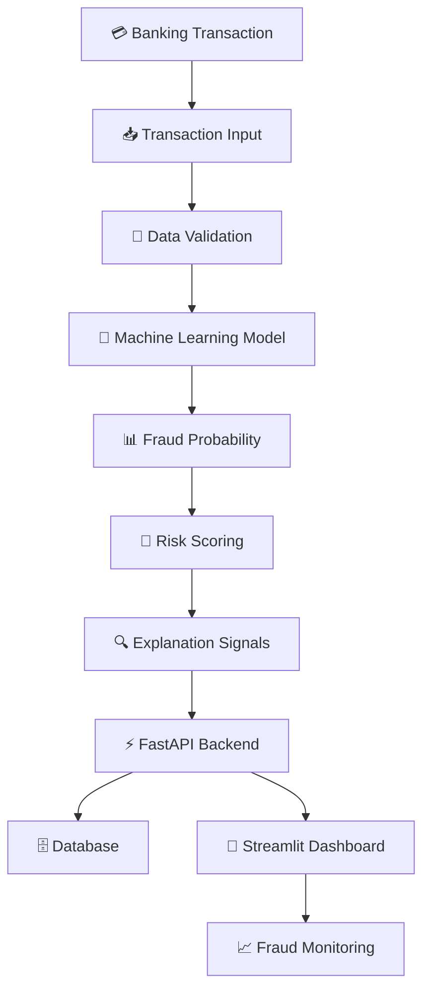

# 🛡️ SentinelGuard
### Real-Time Banking Fraud Intelligence & Explainable Risk Scoring Platform

<p align="center">
  <b>🚀 Detect Fraud | Analyze Risk | Protect Every Transaction</b>
</p>

<p align="center">
  An intelligent machine learning platform designed to detect suspicious banking transactions, calculate fraud risk scores, and provide understandable explanations for predictions.
</p>

<p align="center">
  
  
  
  
</p>

<p align="center">
  
  
</p>

---

## 🌟 About The Project

**SentinelGuard** is a machine learning-based banking fraud detection and risk intelligence platform that analyzes financial transactions and identifies potentially suspicious activities.

The system evaluates transaction details, predicts fraud probability, generates a risk score, and provides explanation signals through an interactive dashboard.

### 🎯 Our Mission

To make digital banking smarter, safer, and more transparent through machine learning and explainable artificial intelligence.

---

## ✨ Key Features

- 🤖 **Machine Learning Fraud Detection** – Identifies potentially fraudulent transactions.
- 📊 **Intelligent Risk Scoring** – Generates risk scores from 0 to 100.
- 🚦 **Risk Classification** – Categorizes transactions into Low, Medium, and High risk.
- 🔍 **Explainable AI** – Displays available transaction explanation signals.
- ⚡ **Real-Time Analysis** – Analyzes transactions through FastAPI.
- 📈 **Interactive Dashboard** – Visualizes transaction and fraud statistics.
- 🗄️ **Transaction History** – Stores and displays analyzed transactions.
- 📥 **CSV Export** – Downloads transaction reports.
- 🔄 **Batch Prediction** – Supports multiple transaction predictions.

---

# 📸 Application Screenshots

Explore the SentinelGuard application through the following screenshots.

## 🏠 1. Dashboard Overview

The main dashboard displays transaction statistics, predicted fraud, legitimate transactions, high-risk alerts, and risk distribution charts.

<p align="center">
  
</p>

---

## 🔍 2. Analyze Transaction

Enter banking transaction details and analyze suspicious activities using the machine learning model.

<p align="center">
  
</p>

---

## 🟢 3. Low Risk Transaction

Displays transactions classified as low risk, indicating a lower predicted fraud probability.

<p align="center">
  
</p>

---

## 🟡 4. Medium Risk Transaction

Displays transactions that require additional verification and monitoring.

<p align="center">
  
</p>

---

## 🔴 5. High Risk Transaction

Highlights potentially suspicious transactions that require priority human review.

<p align="center">
  
</p>

---

## 📜 6. Transaction History

View previously analyzed transactions, filter transactions by risk level, and download CSV reports.

<p align="center">
  
</p>

---

## 🧠 How SentinelGuard Works



### Workflow

1. User enters banking transaction details.
2. Backend validates transaction data.
3. Machine learning model analyzes the transaction.
4. Fraud probability is calculated.
5. Risk score is generated.
6. Transaction is classified into a risk category.
7. Explanation signals are returned.
8. Transaction information is stored in the database.
9. Dashboard displays the prediction results.

---

## 🚦 Risk Classification

SentinelGuard uses a risk score between 0 and 100.

| Risk Score | Risk Level | Suggested Action |
|---|---|---|
| 0–30 | 🟢 Low | Normal monitoring |
| 31–70 | 🟡 Medium | Additional verification |
| 71–100 | 🔴 High | Priority human review |

> A risk prediction is not proof of fraud. Human verification is important before taking action.

---

## 🛠️ Technology Stack

| Category | Technologies |
|---|---|
| Programming Language | Python |
| Data Processing | Pandas, NumPy |
| Machine Learning | Scikit-learn, Random Forest |
| Model Enhancements | XGBoost, SMOTE |
| Explainable AI | SHAP, LIME |
| Backend | FastAPI, Pydantic |
| Frontend | Streamlit |
| Visualization | Plotly |
| Database | SQLite, PostgreSQL |
| ORM | SQLAlchemy |
| Deployment Plans | Docker, AWS |
| Version Control | Git, GitHub |

*Some technologies are planned enhancements and may not yet be integrated into the current implementation.*

---

## 📂 Project Structure

```text
SentinelGuard/
│
├── backend/
│   ├── main.py
│   └── database.py
│
├── frontend/
│   └── app.py
│
├── src/
│   ├── preprocessing/
│   │   └── validation.py
│   │
│   ├── prediction/
│   │   └── engine.py
│   │
│   └── training/
│       └── train.py
│
├── data/
│   └── transactions.csv
│
├── models/
│   └── trained_model.pkl
│
├── screenshots/
│   ├── dashboard.png
│   ├── analyze-transaction.png
│   ├── low-risk.png
│   ├── medium-risk.png
│   ├── high-risk.png
│   └── transaction-history.png
│
├── tests/
├── requirements.txt
├── README.md
└── .gitignore
```

---

## ⚙️ Installation & Setup

### 1. Clone Repository

```bash
git clone https://github.com/Abhi-munnoli/SentinelGuard.git
```

### 2. Open Project Folder

```bash
cd SentinelGuard
```

### 3. Create Virtual Environment

```bash
python -m venv venv
```

Activate the environment on Windows:

```bash
venv\Scripts\activate
```

### 4. Install Dependencies

```bash
pip install -r requirements.txt
```

### 5. Train the Machine Learning Model

```bash
python -m src.training.train
```

### 6. Start FastAPI Backend

```bash
uvicorn backend.main:app --reload
```

Backend:

```text
http://127.0.0.1:8000
```

API Documentation:

```text
http://127.0.0.1:8000/docs
```

### 7. Start Streamlit Dashboard

Open another terminal:

```bash
streamlit run frontend/app.py
```

Dashboard:

```text
http://localhost:8501
```

🎉 SentinelGuard is now running locally!

---

## 🧪 Example Transaction Inputs

### 🟢 Low Risk Example

```json
{
  "amount": 500,
  "hour": 14,
  "distance_from_home": 2,
  "merchant_risk": 0.05,
  "transaction_velocity": 1,
  "is_foreign": 0,
  "device_changed": 0
}
```

### 🟡 Medium Risk Example

```json
{
  "amount": 15000,
  "hour": 21,
  "distance_from_home": 80,
  "merchant_risk": 0.50,
  "transaction_velocity": 4,
  "is_foreign": 0,
  "device_changed": 1
}
```

### 🔴 High Risk Example

```json
{
  "amount": 50000,
  "hour": 2,
  "distance_from_home": 450,
  "merchant_risk": 0.95,
  "transaction_velocity": 8,
  "is_foreign": 1,
  "device_changed": 1
}
```

*These are illustrative scenarios. The trained model determines the actual prediction and risk score.*

---

## 🔍 Explainable AI

SentinelGuard aims to make fraud predictions understandable by displaying transaction-related explanation signals.

Features analyzed include:

- 💰 Transaction amount
- 🕒 Transaction time
- 📍 Distance from home
- 🏪 Merchant risk
- 🔄 Transaction velocity
- 🌍 Foreign transaction
- 📱 New device detection

SHAP and LIME can provide more detailed feature-contribution explanations when fully integrated.

---

## 🔌 API Endpoints

| Method | Endpoint | Description |
|---|---|---|
| GET | `/health` | Backend health check |
| POST | `/predict` | Predict one transaction |
| POST | `/predict/batch` | Predict multiple transactions |
| GET | `/transactions` | Retrieve transaction history |
| GET | `/metrics` | Retrieve dashboard metrics |

---

## 🚀 Future Enhancements

- Advanced XGBoost model comparison.
- Full SHAP and LIME integration.
- Apache Kafka real-time streaming.
- PostgreSQL database integration.
- User authentication and authorization.
- Automated fraud alerts.
- Docker containerization.
- AWS cloud deployment.
- Advanced model monitoring.

---

## 👨‍💻 Developer

<p align="center">
  <b>Abhinandan Munnoli</b>
  <br/>
  Python | Machine Learning | Artificial Intelligence
</p>

<p align="center">
  <a href="https://github.com/Abhi-munnoli">
    
  </a>
  <a href="https://github.com/Abhi-munnoli/SentinelGuard">
    
  </a>
</p>

---

## ⭐ Support This Project

If you like SentinelGuard:

- ⭐ Star this repository.
- 🍴 Fork the project.
- 🐛 Report bugs.
- 💡 Suggest improvements.
- 🤝 Contribute to development.

---

<p align="center">
  <b>🛡️ SentinelGuard</b>
  <br/>
  Smarter Detection. Safer Banking. Stronger Trust.
  <br/><br/>
  Made with ❤️ using Python and Machine Learning.
</p>
